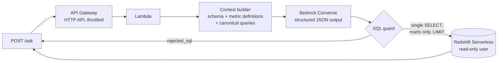

# Metric Layer + Natural-Language Query

**Ask "what was our on-time delivery rate last quarter?" in plain English, get the number the business agreed on, and never run unsafe SQL.**

Two people computing "on-time delivery rate" from the same tables often get different numbers: one divides by racks ordered, the other by racks delivered; one anchors on order date, the other on delivery date. A natural-language query tool that writes its own definitions makes that worse. This project fixes the definitions first, then uses them to ground the model, and measures whether grounding actually helps.

It has two parts, built on the marts of [rack-delivery-pipeline](https://github.com/meetshah27/rack-delivery-pipeline):

1. **A governed metric layer:** 12 KPIs defined once in the dbt Semantic Layer (MetricFlow), enforced contracts on every mart, and a generated metric dictionary.
2. **An NLQ service:** API Gateway to Lambda to Amazon Bedrock. It turns a question into SQL grounded in those definitions, checks the SQL with a parser-based guard, runs it read-only on Redshift Serverless, and returns the rows with the SQL and assumptions for audit.

## The metric layer

Each KPI has exactly one machine-readable definition, an owner, a refresh SLA and a canonical query. Nothing else is allowed to define it: the dictionary is generated from the semantic YAML, and CI fails if it goes stale.

| Metric | Definition | Anchored on |
|---|---|---|
| `racks_ordered` | Racks with an order placed | order date |
| `racks_to_production` | Racks reaching production | production date |
| `on_time_delivery_rate` | Completed racks in production by their SLA due date, as a share of completed racks | production date |
| `racks_on_time` | Completed racks within SLA | production date |
| `p50_end_to_end_days` / `p90_end_to_end_days` | Median / 90th percentile order-to-production days | production date |
| `avg_vendor_lead_days` | Mean order-to-ship days | ship date |
| `avg_install_days` | Mean received-to-cabled days | cabled date |
| `racks_in_flight` | Racks ordered and not yet in production (current state) | snapshot |
| `overdue_open_racks` | In-flight racks past their SLA due date (current state) | snapshot |
| `sla_breach_count` | Completed racks that missed SLA | production date |
| `burn_in_regression_rate` | Completed racks with at least one status regression, as a share of completed racks | production date |

Full definitions, formulas, owners and exclusions: [docs/generated/metric_dictionary.md](docs/generated/metric_dictionary.md).

**Verified:**

| Check | Result |
|---|---|
| `mf validate-configs` (YAML, semantics, every metric run against the warehouse) | 0 errors, 0 warnings |
| Canonical query per metric vs `mf query --group-by metric_time__month` | 12 of 12 return identical results, month by month |
| Contract enforcement | Changing a mart column's type fails `dbt build` before the table is replaced ([demo](docs/contract_demo.md)) |
| Dictionary | Byte-identical on regeneration; every approved metric present with matching owner, grain, source and SLA |

**Rates are ratio metrics, not expressions.** `on_time_delivery_rate` is defined as `racks_on_time / racks_to_production`, so across vendors, sites or months it pools numerators and denominators rather than averaging per-group rates. This is the "ratio trap" the evaluation tests directly.

How definitions change, who approves, and how a breaking mart change is versioned and deprecated: [docs/GOVERNANCE.md](docs/GOVERNANCE.md).

## The NLQ service



1. The question (5 to 500 characters) is validated with pydantic.
2. The context builder grounds the model. `schema_only` mode gives it table and column descriptions. `grounded` mode adds every metric's definition, formula, time anchor, exclusions and canonical query, read from the compiled semantic manifest.
3. Bedrock returns structured JSON, `{metric_used, can_answer, sql, assumptions}`, at temperature 0. The prompt sets default rules for vague questions: no window means the last complete month, weeks start Monday, "how are we doing" means on-time delivery rate, and so on. The model must list every interpretation it made.
4. If the data can't answer the question (cost, pricing, staffing, forecasts), the response is `refused`.
5. The guard checks the SQL before anything runs (below).
6. The query runs through the Redshift Data API as a database user that can only `SELECT` from `marts`.
7. The response returns `status`, `metric_used`, the SQL, the assumptions, the rows, latency, model ID and prompt hash.

**The SQL guard** is defense in depth, not trust in the prompt:

- The SQL is parsed with sqlglot in the target dialect. It must be exactly one statement, a `SELECT` or a `WITH ... SELECT`.
- Every table reference must resolve to the `marts` schema, so system tables (`pg_catalog`, `stl_*`) and `raw` are rejected.
- Denylisted system functions are rejected.
- `LIMIT 1000` is appended when absent.
- An `EXPLAIN` cost ceiling applies before execution.
- Even SQL that gets past the guard runs as a user with read access to `marts` only, and a test asserts that this user cannot `CREATE TABLE`.

**Two execution backends behind one interface:** Redshift via the Data API, and a local DuckDB copy of the marts, so the whole service and its evaluation run without AWS.

## How accuracy is measured

A fixed golden set of **60 questions** was written against the governed definitions before any prompt existed. It has 52 hand-written ground-truth queries and 9 accepted alternatives for genuinely ambiguous questions.

| Category | Questions | Tests |
|---|---|---|
| simple_metric | 12 | One metric, one filter |
| time_window | 10 | "Last quarter", "trailing 90 days", month over month |
| group_by_rank | 10 | "Which 3 sites had the worst p90 install time" |
| multi_join | 8 | SCD2 contract versions, several dimensions |
| ratio_trap | 6 | Where averaging per-group rates gives the wrong answer |
| ambiguous | 6 | Must pick the default metric and state the assumption |
| should_refuse | 8 | Cost, pricing, staffing, forecasts, a write request |

- **Execution accuracy, not string matching.** A generated answer is correct when its result set matches the ground truth: same rows, each ground-truth column mapped to a distinct generated column with equal values. Column names and order are ignored, and numbers are compared with a tolerance. No LLM judges correctness.
- **Two modes, same code path as the API.** `schema_only` vs `grounded`. The difference between them is the headline result.
- **Repeated runs.** Each run is repeated three times, reporting mean and minimum, with the prompt hash, model ID and git SHA recorded.
- **An untouched holdout.** 15 of the 60 questions are never read during prompt iteration and run only once, on the final prompt. Prompt changes must be general rules tied to a labeled failure, never question-specific hints, with at most two iterations. The holdout accuracy is the honest number.
- **Failure taxonomy.** Every miss gets one label, assigned in a fixed order: SQL error, should have refused, refused wrongly, hallucinated column, wrong metric, wrong date window, wrong filter, wrong aggregation.
- **Also reported:** refusal precision and recall, guard rejections, latency at p50 and p95 per step, and Bedrock tokens and cost per question.

Full spec: [docs/EVAL_SPEC.md](docs/EVAL_SPEC.md).

## Repository layout

```
src/nlq/          handler, context builder, Bedrock generation, SQL guard, execution backends, schemas, dictionary generator
prompts/          versioned system prompts; every eval run records the prompt hash
eval/golden/      60 questions, ground-truth and alternative SQL (fixed)
eval/             harness, result-set comparison, reports and SUMMARY
artifacts/        compiled semantic manifest pinned from rack-delivery-pipeline
docs/             spec, approved metrics, NLQ and eval specs, governance, contract demo, generated dictionary and canonical queries
infra/            Terraform: Lambda, HTTP API, scoped IAM
```

## How to run

Prerequisites: [uv](https://docs.astral.sh/uv/) and GNU Make; Python 3.12 is installed by uv. The semantic models live in the rack-delivery-pipeline dbt project; point `P1_DBT_DIR` at it (default `../p1-rack-delivery-pipeline/dbt`).

```sh
make setup
make mf-validate        # validate the semantic layer
make sync-artifacts     # pin the compiled semantic manifest
make dictionary         # regenerate docs/generated/metric_dictionary.md
make test               # dictionary checks; canonical queries vs MetricFlow when the warehouse is present
make deploy             # Lambda + HTTP API
make ask Q="What was the on-time delivery rate last quarter?"
make eval PROMPT=system_v1 MODE=grounded
```

Bedrock model IDs come from `BEDROCK_MODEL_ID` (final runs) and `BEDROCK_MODEL_ID_DEV` (a small model for iteration), never from code.

## Implementation status

| Part | Status |
|---|---|
| Metric layer: semantic models, 12 metrics, enforced contracts, canonical queries, dictionary, governance | Built and verified (above) |
| Golden set: 60 questions, ground-truth and alternative SQL | Written and fixed |
| NLQ service, SQL guard, eval harness, Bedrock runs, deployment | Specified in `docs/`, not yet built; deployment runs in one cost-capped AWS window and is torn down afterwards |

## Limitations

- `racks_in_flight` and `overdue_open_racks` describe current state. MetricFlow needs a time anchor, so grouping them by month splits them by order date.
- The rack data is synthetic (see rack-delivery-pipeline), so accuracy reflects these schemas and questions, not a general claim about text-to-SQL.
- Single-turn questions only: no follow-ups, no write access, no fine-tuning.
